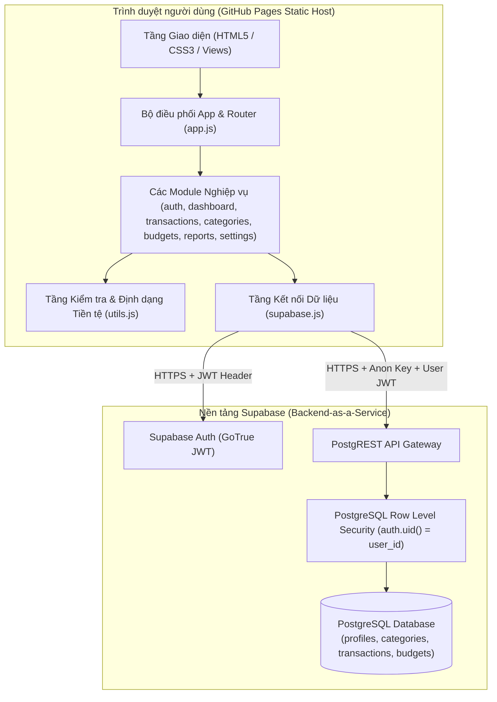

# Kiến Trúc Hệ Thống (`ARCHITECTURE.md`)

## 1. Sơ đồ Kiến trúc Tổng thể (System Architecture)

Ứng dụng tuân thủ mô hình **Serverless Static Single-Page Application (SPA)** kết hợp với **Backend-as-a-Service (Supabase)**, cho phép triển khai trực tiếp trên **GitHub Pages** mà không cần máy chủ trung gian (Node.js/PHP/Python), đồng thời vẫn đảm bảo bảo mật cấp cơ sở dữ liệu thông qua **PostgreSQL Row Level Security (RLS)**.



---

## 2. Nguyên tắc Thiết kế Kiến trúc (Architectural Principles)

Áp dụng từ skill `software-architecture`:
1. **Tách biệt trách nhiệm (Separation of Concerns):**
   - `index.html` & `assets/css/*`: Chịu trách nhiệm cấu trúc ngữ nghĩa HTML5 và hệ thống thiết kế giao diện (Design Tokens, Layout, Responsive).
   - `assets/js/supabase.js`: Đóng gói kết nối Supabase Client và cung cấp giao diện truy cập dữ liệu thống nhất (Data Access Layer), hỗ trợ cả kết nối Supabase Cloud thực tế và bộ mô phỏng PostgreSQL RLS chuẩn xác phục vụ kiểm thử tự động 2 tài khoản khi chạy CI/Offline.
   - `assets/js/auth.js`: Quản lý vòng đời xác thực (Đăng ký, Đăng nhập, Đăng xuất, Khôi phục mật khẩu, Khởi tạo danh mục mặc định).
   - `assets/js/transactions.js`, `categories.js`, `budgets.js`, `dashboard.js`, `reports.js`, `settings.js`: Mỗi module đảm nhận đúng một miền nghiệp vụ (Bounded Context).
   - `assets/js/utils.js`: Chứa các hàm thuần khiết (Pure Functions) xử lý tiền tệ số nguyên (`VND`), ngày tháng, làm sạch chuỗi chống XSS (`escapeHtml`), kiểm tra dữ liệu đầu vào (`validateTransactionInput`, `validateBudgetInput`).
2. **Không phụ thuộc đường dẫn gốc (Subpath-Safe Static Routing):**
   - Mọi tài nguyên tĩnh và ES Modules đều sử dụng đường dẫn tương đối (`./assets/...`), đảm bảo hoạt động chính xác trên `https://USERNAME.github.io/REPOSITORY/`.
   - Điều hướng giữa các màn hình (Dashboard, Giao dịch, Danh mục, Ngân sách, Báo cáo, Cài đặt) sử dụng Hash/State-based SPA navigation, không gây lỗi `404 Not Found` khi tải lại trang trên GitHub Pages.
3. **Chính xác Số học Tiền tệ (Exact Financial Arithmetic):**
   - Tiền tệ VND không có phần thập phân lẻ trong giao dịch thực tế, và trong CSDL được lưu trữ bằng `NUMERIC(18, 0)` (hoặc `BIGINT` tương đương).
   - Trên JavaScript, mọi phép tính tổng thu, tổng chi, số dư, tỷ lệ ngân sách đều ép kiểu và tính toán qua số nguyên an toàn (`Math.round` / `BigInt` helper), ngăn chặn triệt để sai số dấu phẩy động IEEE 754.

---

## 3. Cấu trúc Thư mục Dự án (Project Structure)

```text
chitieu/
├── index.html                      # Trang ứng dụng chính (SPA Shell)
├── test-runner.html                # Giao diện chạy kiểm thử tự động E2E & RLS 2 tài khoản trên trình duyệt
├── README.md                       # Hướng dẫn cài đặt, cấu hình Supabase và triển khai GitHub Pages
├── style.md                        # Mô tả phong cách thiết kế Editorial / Financial Paper
├── yeucau.md                       # Tài liệu yêu cầu gốc
├── .gitignore                      # Loại trừ các tệp tạm và cấu hình nhạy cảm cục bộ
│
├── assets/
│   ├── css/
│   │   ├── variables.css           # Hệ thống Design Tokens (Màu sắc Light/Dark, Typography, Spacing)
│   │   ├── main.css                # Bố cục khung trang, Sidebar, Topbar, Auth layout
│   │   ├── components.css          # Thẻ KPI, Bảng dữ liệu, Modal Dialog, Badges, Progress Bars, Toast
│   │   └── responsive.css          # Quy tắc thích ứng Mobile-First (320px -> 1440px) & Print
│   │
│   ├── js/
│   │   ├── config.js               # Cấu hình SUPABASE_URL, SUPABASE_PUBLISHABLE_KEY và hằng số
│   │   ├── supabase.js             # Khởi tạo Supabase Client & RLS-compliant Data Service
│   │   ├── utils.js                # Định dạng VND, ngày tháng, Sanitization, Validation, Toast, Modal
│   │   ├── auth.js                 # Xác thực người dùng & quản lý phiên
│   │   ├── dashboard.js            # Logic thống kê tổng quan & biểu đồ Dashboard
│   │   ├── transactions.js         # CRUD giao dịch, tìm kiếm, bộ lọc, sắp xếp, phân trang
│   │   ├── categories.js           # CRUD danh mục, kiểm tra ràng buộc khóa ngoại trước khi xóa
│   │   ├── budgets.js              # Quản lý ngân sách tháng/danh mục & cảnh báo 80% / 100%
│   │   ├── reports.js              # Báo cáo phân tích tháng/năm, biểu đồ Chart.js & xuất CSV
│   │   ├── settings.js             # Quản lý hồ sơ, giao diện Sáng/Tối, cấu hình kết nối
│   │   └── app.js                  # Điểm khởi chạy ứng dụng, điều phối sự kiện & định tuyến
│   │
│   └── images/
│       └── favicon.svg             # Biểu tượng ứng dụng
│
├── supabase/
│   ├── schema.sql                  # Lược đồ bảng, khóa ngoại, CHECK constraints, Triggers & Indexes
│   ├── policies.sql                # Chính sách bảo mật Row Level Security (RLS) cho 4 bảng
│   ├── seed.sql                    # Hàm khởi tạo danh mục mặc định và dữ liệu mẫu an toàn
│   └── test_rls.sql                # Script kiểm chứng RLS bằng 2 tài khoản trực tiếp trên PostgreSQL
│
├── tests/
│   └── security-and-crud.test.mjs  # Bộ test tự động kiểm thử 2 tài khoản (User A & User B), CRUD & Validation
│
├── docs/
│   ├── REQUIREMENTS.md             # Đặc tả yêu cầu hệ thống
│   ├── ARCHITECTURE.md             # Tài liệu kiến trúc hệ thống
│   ├── DATABASE_DESIGN.md          # Phân tích CSDL quan hệ, chuẩn hóa BCNF & thiết kế vật lý
│   ├── SECURITY.md                 # Mô hình mối đe dọa, chính sách RLS & phòng chống lỗ hổng
│   ├── TESTING.md                  # Kịch bản kiểm thử (Test Cases) & Báo cáo kết quả thực thi
│   └── SKILL_USAGE.md              # Hồ sơ khám phá và ứng dụng Agent Skills
│
└── .github/
    └── workflows/
        └── deploy.yml              # GitHub Actions tự động kiểm thử và triển khai lên GitHub Pages
```
