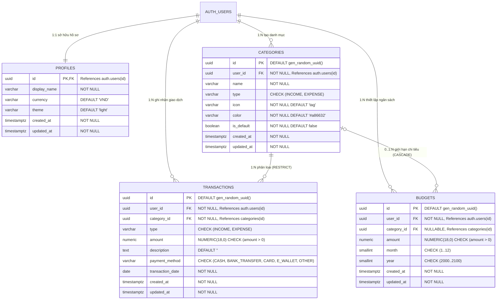

# Thiết Kế Cơ Sở Dữ Liệu Quan Hệ (`DATABASE_DESIGN.md`)

Tài liệu này áp dụng quy trình thiết kế nghiêm ngặt từ skill `relational-data-modeling` và `sql-pro`: phân tích nghiệp vụ → mô hình hóa ERD → ánh xạ quan hệ → phân tích phụ thuộc hàm & khóa ứng viên → kiểm chứng dạng chuẩn BCNF → thiết kế vật lý PostgreSQL kèm Row Level Security (RLS).

---

## 1. Phân tích Thực thể & Quy tắc Nghiệp vụ (Business Rules)

| Mã quy tắc | Nội dung quy tắc nghiệp vụ | Cơ chế thực thi trong PostgreSQL |
|------------|----------------------------|----------------------------------|
| **BR-01** | Mỗi người dùng (`auth.users`) có duy nhất một hồ sơ cá nhân (`profiles`). | `PRIMARY KEY (id)` tham chiếu `auth.users(id) ON DELETE CASCADE`. |
| **BR-02** | Mỗi danh mục (`categories`) thuộc về một người dùng cụ thể và thuộc một trong hai loại: `INCOME` hoặc `EXPENSE`. | `user_id NOT NULL REFERENCES auth.users(id)`, `CHECK (type IN ('INCOME', 'EXPENSE'))`, `UNIQUE (user_id, type, lower(name))`. |
| **BR-03** | Không được phép xóa danh mục đang được tham chiếu bởi bất kỳ giao dịch nào của người dùng. | `category_id UUID NOT NULL REFERENCES public.categories(id) ON DELETE RESTRICT`. |
| **BR-04** | Mỗi giao dịch (`transactions`) phải có số tiền nguyên dương (`amount > 0`) và loại giao dịch khớp với `INCOME` hoặc `EXPENSE`. | `amount NUMERIC(18, 0) NOT NULL CHECK (amount > 0)`, `CHECK (type IN ('INCOME', 'EXPENSE'))`. |
| **BR-05** | Ngân sách (`budgets`) được đặt theo từng tháng (`1..12`) và năm (`2000..2100`), số tiền dương (`amount > 0`). Có thể là ngân sách tổng tháng (`category_id IS NULL`) hoặc ngân sách riêng cho một danh mục (`category_id IS NOT NULL`). | Hai Unique Partial Indexes để chống trùng lặp ngân sách trong cùng `(user_id, month, year)` cho cả trường hợp `category_id IS NULL` và `category_id IS NOT NULL`. |
| **BR-06** | **Cô lập dữ liệu tuyệt đối (Multi-tenant Isolation):** Người dùng chỉ được phép truy xuất và thao tác trên các bản ghi có `user_id = auth.uid()`. | Bật `ROW LEVEL SECURITY` trên cả 4 bảng với đầy đủ 4 chính sách `SELECT`, `INSERT`, `UPDATE`, `DELETE`. |

---

## 2. Sơ đồ Thực thể - Liên kết (Mermaid ERD)

---

## 3. Phân tích Phụ thuộc Hàm & Chứng minh Chuẩn hóa (3NF / BCNF)

### 3.1. Lược đồ `profiles(id, display_name, currency, theme, created_at, updated_at)`
- **Tập phụ thuộc hàm $F_1$:** $\{ \text{id} \to \text{display\_name}, \text{currency}, \text{theme}, \text{created\_at}, \text{updated\_at} \}$.
- **Bao đóng:** $\{\text{id}\}^+ = R_1$, và $\text{id}$ là thuộc tính đơn $\Rightarrow$ Khóa ứng viên duy nhất $CK_1 = \{\text{id}\}$.
- **Dạng chuẩn:** Mọi phụ thuộc hàm không tầm thường đều có vế trái là siêu khóa $\Rightarrow$ **Đạt chuẩn BCNF**.

### 3.2. Lược đồ `categories(id, user_id, name, type, icon, color, is_default, created_at, updated_at)`
- **Tập phụ thuộc hàm $F_2$:**
  - $fd_{2.1}: \text{id} \to \{\text{user\_id}, \text{name}, \text{type}, \text{icon}, \text{color}, \text{is\_default}, \text{created\_at}, \text{updated\_at}\}$
  - $fd_{2.2}: \{\text{user\_id}, \text{type}, \text{name}\} \to \{\text{id}, \text{icon}, \text{color}, \text{is\_default}, \text{created\_at}, \text{updated\_at}\}$ (trong phạm vi một người dùng và một loại thu/chi, tên danh mục là duy nhất).
- **Khóa ứng viên (Candidate Keys):**
  - $CK_{2.1} = \{\text{id}\}$ (Surrogate Key)
  - $CK_{2.2} = \{\text{user\_id}, \text{type}, \text{name}\}$ (Natural Composite Key, cả 3 thuộc tính đều cần thiết vì nếu bỏ bất kỳ thuộc tính nào thì bao đóng không suy ra được $\text{id}$).
- **Dạng chuẩn:** Cả $fd_{2.1}$ và $fd_{2.2}$ đều có vế trái là Siêu khóa (Super Key) $\Rightarrow$ **Đạt chuẩn BCNF**.

### 3.3. Lược đồ `transactions(id, user_id, category_id, type, amount, description, payment_method, transaction_date, created_at, updated_at)`
- **Tập phụ thuộc hàm $F_3$:**
  - $fd_{3.1}: \text{id} \to \{\text{user\_id}, \text{category\_id}, \text{type}, \text{amount}, \text{description}, \text{payment\_method}, \text{transaction\_date}, \text{created\_at}, \text{updated\_at}\}$
- **Lưu ý thiết kế:** Cột `type` trên `transactions` được đồng bộ và kiểm chứng khớp với `categories.type` thông qua Trigger `fn_validate_transaction_category()` để đảm bảo:
  1. Không xảy ra dị thường cập nhật (Update Anomaly): Một giao dịch không bao giờ trỏ tới danh mục của người dùng khác hoặc danh mục sai loại Thu/Chi.
  2. Tối ưu hóa truy vấn tổng hợp (OLAP/Dashboard query optimization): Cho phép tính tổng `SUM(amount)` theo `(user_id, type, transaction_date)` trực tiếp qua Composite Index mà không cần `JOIN` sang bảng `categories` trên mỗi lần tải Dashboard.

### 3.4. Lược đồ `budgets(id, user_id, category_id, amount, month, year, created_at, updated_at)`
- **Tập phụ thuộc hàm $F_4$:**
  - $fd_{4.1}: \text{id} \to \{\text{user\_id}, \text{category\_id}, \text{amount}, \text{month}, \text{year}, \text{created\_at}, \text{updated\_at}\}$
  - $fd_{4.2}: \{\text{user\_id}, \text{category\_id}, \text{month}, \text{year}\} \to \{\text{id}, \text{amount}, \text{created\_at}, \text{updated\_at}\}$
- **Xử lý `NULL` trong PostgreSQL Unique Constraint:**
  - Trong chuẩn SQL, `UNIQUE (user_id, category_id, month, year)` mặc định coi hai giá trị `NULL` của `category_id` là khác nhau, dẫn đến nguy cơ tạo nhiều ngân sách tổng trong cùng 1 tháng.
  - **Giải pháp kỹ thuật:** Sử dụng 2 Partial Unique Indexes:
    1. `idx_budgets_unique_overall ON public.budgets (user_id, year, month) WHERE category_id IS NULL`
    2. `idx_budgets_unique_category ON public.budgets (user_id, category_id, year, month) WHERE category_id IS NOT NULL`
  - Nhờ đó, ràng buộc khóa ứng viên tự nhiên $CK_{4.2}$ được bảo toàn tuyệt đối ở mức vật lý (**Đạt chuẩn BCNF**).

---

## 4. Chiến lược Đánh chỉ mục (Indexing Strategy)

Áp dụng từ `sql-optimization-patterns`:
1. **`idx_transactions_user_date` (`user_id, transaction_date DESC, created_at DESC`):** Phục vụ truy vấn phân trang danh sách giao dịch và lọc theo khoảng thời gian trên Dashboard/Reports (Index Scan thay vì Seq Scan).
2. **`idx_transactions_user_type_date` (`user_id, type, transaction_date`):** Phục vụ thống kê nhanh Tổng Thu / Tổng Chi theo tháng.
3. **`idx_transactions_category` (`category_id`):** Tăng tốc kiểm tra khóa ngoại `ON DELETE RESTRICT` khi xóa danh mục và khi gom nhóm chi tiêu theo danh mục.
4. **`idx_categories_user_type` (`user_id, type`):** Tăng tốc tải danh mục Thu/Chi cho biểu mẫu và bộ lọc.
5. **`idx_budgets_user_period` (`user_id, year, month`):** Tăng tốc truy vấn ngân sách của tháng hiện tại.
